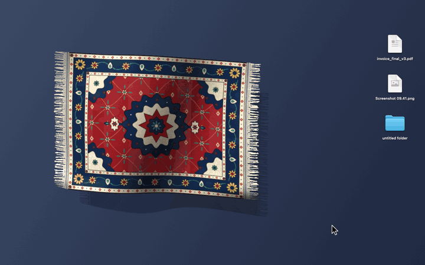

# Under the Rug

A Persian rug that lives on your Mac desktop. Shove files under it.



## Download

Grab `UnderTheRug-<version>.zip` from the [latest release](https://github.com/mike-hendriks/under-the-rug-app/releases/latest), unzip it and move **Under the Rug** to Applications. It runs on macOS 13 or later, on Apple silicon and Intel.

The app is not notarized by Apple, so macOS blocks the first launch. Open it once, then go to **System Settings → Privacy & Security** and click **Open Anyway**.

## What it does

- **Drop files on a rug** to shove them under. They move to `~/Library/Application Support/Under the Rug/Stash` and show up as lumps in the cloth.
- **Drag a rug** to pull it around, also onto another display. It is a heavy Verlet cloth: it wrinkles, lifts where you hold it and settles flat again.
- **Double-click** an end of a rug to fold it back up to that point. Your hidden files lie on the desktop underneath: drag them out, or double-click to open. Double-click again to lay it flat.
- **Add a Rug (⌘N)** puts down another one. Each rug has its own style (ten of them, from Tabriz Crimson to Acid Bazaar), size and hidden files. Right-click a rug for its menu.
- **Bring the Rugs Back (⌘R)** lays every rug flat in the middle of the screen, for when you threw one too far.
- **Sweep the Desktop Under It…** moves everything on your Desktop under a rug in one go. **Pull Everything Back Out** puts every file back where it came from.

Files are only ever moved, never deleted. Desktop icons beneath a rug are covered by it, because the rug windows sit just above the Finder's icon layer.

## Build

Needs macOS 13+ and the Command Line Tools (no Xcode).

```bash
./build-app.sh
open "build/Under the Rug.app"
```

## Release

Pushing a version tag builds a universal app on GitHub Actions and attaches it to a new release:

```bash
git tag v1.1.0 && git push origin v1.1.0
```

## Development

```bash
swift build -c release
.build/release/UnderTheRug --export-textures /tmp/rugs           # every rug style as PNG
.build/release/UnderTheRug --snapshot /tmp/rug.png --fold        # offscreen render (also --grab, --style id)
.build/release/UnderTheRug --demo docs/demo.gif                  # the launch GIF above
```

| File | What it does |
| --- | --- |
| `RugPattern.swift` | Procedural rug artwork: fringe, borders, field lattice, medallion |
| `RugStyle.swift` | The colour schemes |
| `ClothSimulation.swift` | Verlet cloth with shape matching, folding, lumps and grabbing |
| `RugWorld.swift` | All rugs in global screen space, hit testing, keeping rugs on screen |
| `RugRenderer.swift`, `Shaders.swift` | Metal: stacked rugs, shadows, pile and knot shading, the back of the rug |
| `RugView.swift` | One view per screen: mouse, drag and drop in both directions |
| `Stash.swift` | Moves files under a rug and back |
| `AppDelegate.swift` | Windows per screen, click-through, menu bar |
| `Offscreen.swift` | Renders rugs without a window, with a camera |
| `LaunchDemo.swift` | The scripted launch GIF: kinetic type, camera moves, the rugs doing their thing |
